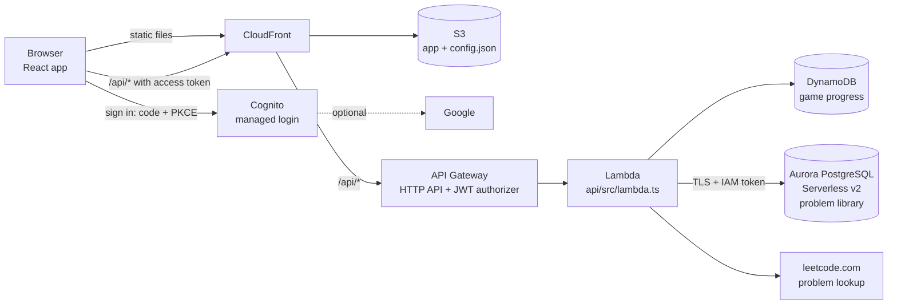

# Architecture

PokéLeet is a React app with a small HTTP API. The same app and API run in
three setups; only where the data is stored changes.

| Setup | How it runs | Where data lives | Sign-in |
| --- | --- | --- | --- |
| **Local** (`npm start`) | Vite dev server with the API as a plugin | JSON files in `data/` | none (one local user) |
| **Cloud** (your AWS account) | CloudFront + API Gateway + Lambda | DynamoDB (game progress) and Aurora PostgreSQL (problem library) | Cognito: email, or Google |
| **Demo** (GitHub Pages, or the cloud app's `?demo`) | static files only | the browser's localStorage | none |

## The cloud deployment



- **One origin.** CloudFront serves the app and forwards `/api/*` to API
  Gateway, so the app calls `/api/...` the same way it does locally, with no
  CORS.
- **Auth at the edge.** API Gateway checks every request's Cognito access
  token before the Lambda runs. The Lambda takes the user id from the token's
  `sub` claim and never sees an unauthenticated request.
- **Signing in.** Signed-out visitors get a small sign-in screen: Google,
  email (Cognito's sign-in pages, styled in code to match the app), or a demo
  that needs no account ([ADR 8](adr/0008-branded-sign-in-and-google.md)).
  The sign-up page links the privacy policy and terms (`public/privacy.html`,
  `public/terms.html`).
- **Its own address** (optional): e.g. `pokeleet.sharonchen.dev`, with sign-in
  at `auth.pokeleet.sharonchen.dev`, through a Route 53 zone delegated from the
  parent domain ([ADR 10](adr/0010-the-apps-own-domain.md)).
- **People can delete their own account** from the Backups window: their
  data in both databases, then their Cognito user
  ([ADR 9](adr/0009-self-service-account-deletion.md)).
- **No servers to keep warm.** Lambda, API Gateway, DynamoDB (on-demand) and
  Aurora (scales to zero when idle) all cost close to nothing when unused.
  Aurora runs in its express configuration: no VPC, reached over TLS with
  short-lived IAM tokens instead of passwords
  ([ADR 7](adr/0007-aurora-express-configuration-with-iam-sign-in.md)).
- **Infrastructure as code.** Everything above is defined in `infra/` with the
  AWS CDK and deployed by GitHub Actions, which signs in through OIDC, so no AWS
  keys are stored anywhere. See [deploying.md](deploying.md).

## Code layout

```
src/                 the web app (React)
  game/              the game rules: pure, typed functions with no React or browser APIs
  state/             the store (applies game rules, persists the result) and the Focus engine
  platform/          browser integrations: persistence, Tracker extension, sign-in, session storage
  features/<screen>/ one folder per screen (dashboard, summon, quests, ...)
  components/, app/  shared UI and the app shell
api/                 the HTTP API (Hono, TypeScript)
  src/app.ts         routes and validation, shared by every setup
  src/stores/        where documents are kept: files, DynamoDB, Postgres
  src/local/         the local setup (a Vite plugin)
  src/lambda.ts      the cloud setup
  drizzle/           SQL migrations
shared/              used by both: the catalog (tags, languages) and the library schema (Zod)
infra/               AWS CDK app (its own package)
extension/           the PokéLeet Tracker browser extension
```

Dependencies point one way:

```
features, app  ─►  state  ─►  game
                     │
                     └──►  platform
api  ─►  shared  ◄─  game
```

`game/` imports nothing from React or the browser. That's why it can be
unit-tested with a seeded random number generator, and why its rules could
later run on the server (see [ADR 5](adr/0005-game-rules-as-pure-functions.md)).

## Screen sizes

`src/app/screen-size.js` decides how the app fits the window. From 1024px wide
up, it gets its 1280-wide desktop layout, scaled to fill the window. Narrower
than that it uses real pixels and reflows: pages stack, and the whole page
scrolls instead of each panel.

The narrow layouts are `@container screen` rules at the end of `src/theme.css`.
They are container queries because the width that matters is the screen's own,
which a media query can't see once the screen is scaled. They can only change
what is in the stylesheet, so a page's layout (its grid columns, for example)
belongs there and not in an inline style.

## Data

A user's data is two **documents**, saved separately:

- **Game progress**: currencies, the Pokémon collection, team, quests and
  counters (~10–40 KB). It is always read and written whole, by user.
- **Problem library**: the problems you logged (with your code) and your
  custom tags.

Every saved document carries a **revision number**. A save names the revision
it was based on, and the store refuses it (HTTP 409) if the document has moved
on since. A stale tab or a second device can never overwrite newer data. The
web app keeps unsaved changes in the browser until a save is confirmed, retries
failed saves, and picks up changes made elsewhere when a tab comes back into
view (`src/platform/persistence.ts`).

The API depends only on this interface (`api/src/documents.ts`):

```ts
interface DocumentStore<T> {
  load(userId: string): Promise<StoredDoc<T> | null>
  save(userId: string, data: T, baseRev: number): Promise<SaveResult> // throws ConflictError
}
```

### Why both SQL and NoSQL

Each document is stored where its access pattern fits
([ADR 2](adr/0002-postgres-for-the-library-dynamodb-for-progress.md)):

- **Game progress → DynamoDB.** It's a key-value pattern: get or put one item
  per user. The revision check is a conditional write
  (`ConditionExpression: #rev = :base`). Keys follow a single-table design
  (`pk = USER#<id>`, `sk = DOC#progress`), leaving room for more item types
  per user.
- **Problem library → PostgreSQL.** It's relational: problems have many tags,
  custom tags belong to users, and the interesting questions are queries
  (solved per tag, per difficulty, per day). It's stored in normalized tables:

  ```
  libraries    (user_id PK, rev, saved_at)
  problems     (user_id, id) PK, FK → libraries, title, difficulty CHECK, code, solved_on, ...
  problem_tags (user_id, problem_id, tag_id) PK, FK → problems ON DELETE CASCADE, position
  custom_tags  (user_id, id) PK, FK → libraries, name, position
  ```

  A save is one transaction: it locks the user's `libraries` row
  (`SELECT ... FOR UPDATE`), checks the revision, and writes only what
  changed (new or edited problems, deletions, re-tagged problems).

## Validation

`shared/library.ts` defines the library with Zod. The API rejects any save
that doesn't match it (400). The web app's normalizer (`src/game/state.ts`)
cleans up old or hand-edited data so it always matches, and a property-style
test feeds it random input to keep that true.

## Security

- Every API route requires a signed-in user (JWT authorizer in the cloud; the
  local app has exactly one user). Stores are keyed by the token's user id,
  so users can't reach each other's data.
- The web app uses the OAuth 2.0 authorization code flow with PKCE as a public
  client (no client secret in the browser).
- The database accepts only TLS connections signed in with IAM, and there
  are no database passwords. The API's role may sign in only as its own
  database user, which may only read and write the app's tables; only the
  migration Lambda may sign in as the master. The API's role may also
  read/write its one DynamoDB table, nothing else.
- The API stage is rate-limited, and an optional AWS Budgets alert catches
  runaway cost.

## Testing

| What | How | Where |
| --- | --- | --- |
| Game rules | unit tests with a seeded RNG | `src/game/*.test.ts` |
| Every document store | one shared contract suite, run against memory, files, Postgres (PGlite, and a real server over the same connection code as the cloud) and DynamoDB Local | `api/test/stores.test.ts` |
| API routes | requests against the Hono app with in-memory stores | `api/test/app.test.ts` |
| Infrastructure | assertions on the synthesized CloudFormation | `infra/test/` |

CI (`.github/workflows/ci.yml`) runs formatting, lint, type checks, all tests
(with DynamoDB Local and PostgreSQL as service containers), the production build, and a full
`cdk synth`, then deploys `main`.

## Decisions

The reasoning behind the main choices is recorded in [docs/adr](adr/).
